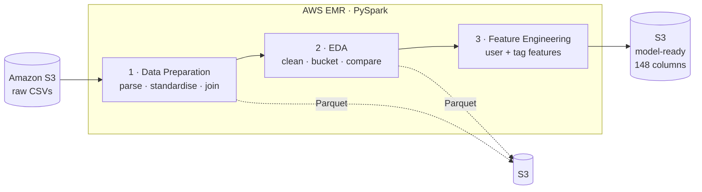
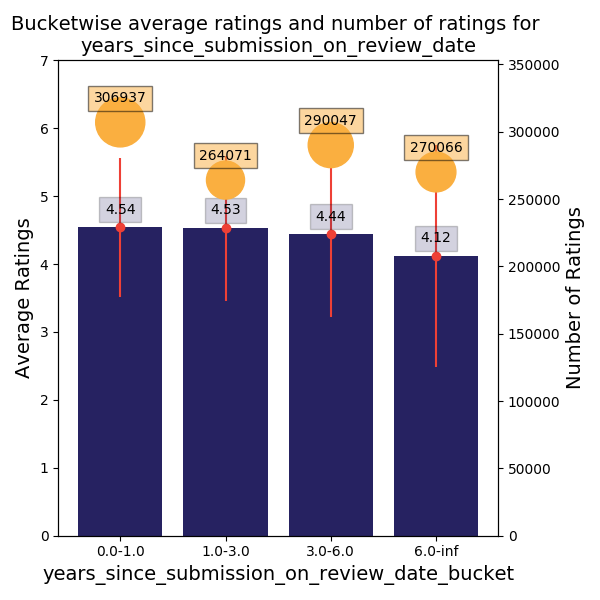
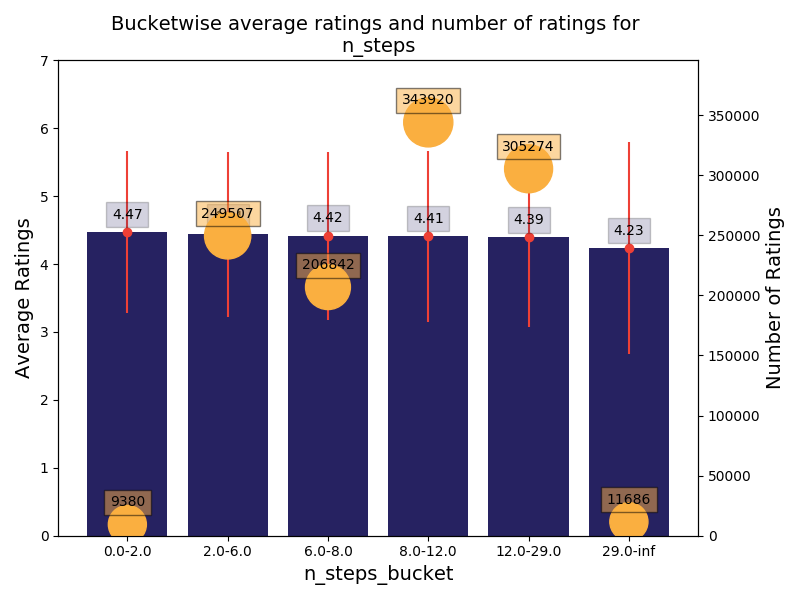
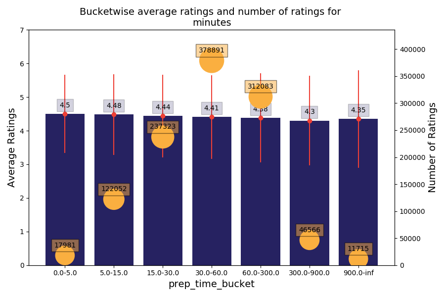
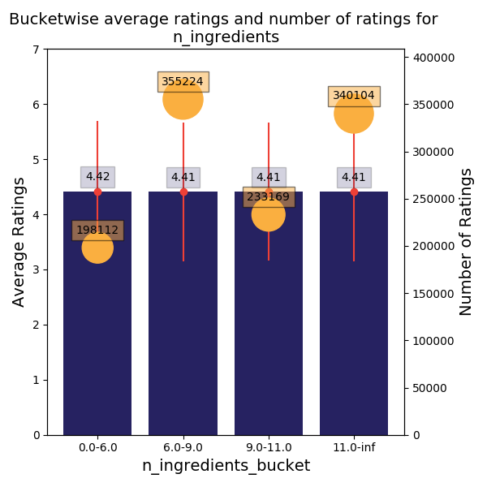

# 🍳 Recipe Rating Analysis with PySpark


A big-data pipeline built with **PySpark on AWS EMR** that processes **1.1 million+ user reviews of 230,000+ recipes** from Food.com. It finds what drives recipe ratings and produces a model-ready dataset of **148 features** for a recipe recommendation system.

---

## 📌 Business Problem

A food recipe platform wants to recommend recipes users are likely to rate highly. Before building a model, it needs to understand which recipe characteristics (prep time, complexity, nutrition, tags) and which user behaviours relate to high ratings, and to turn those insights into features.

## 🗂️ Data

| File | Rows | Description |
|---|---|---|
| `RAW_recipes.csv` | 231,637 | Recipe details: prep time, steps, ingredients, tags, nutrition |
| `RAW_interactions.csv` | 1,132,367 | User reviews: user, recipe, rating (0–5), review text, date |

> Source: [Food.com Recipes and User Interactions](https://www.kaggle.com/datasets/shuyangli94/food-com-recipes-and-user-interactions) (Kaggle). The files are not included in this repo because of their size.

## 🔄 Pipeline



| Notebook | What it does |
|---|---|
| [`01_data_preparation`](notebooks/01_data_preparation.ipynb) | Splits the nutrition string into 7 numeric columns, standardises nutrients per 100 calories, converts tags to arrays, joins recipes to reviews, and creates time-since-submission features |
| [`02_eda_and_bucketing`](notebooks/02_eda_and_bucketing.ipynb) | Removes invalid records, caps outliers, buckets each numerical feature and compares average ratings across buckets |
| [`03_feature_engineering`](notebooks/03_feature_engineering.ipynb) | Builds user-level features with window functions, derives preferences from 5-star ratings, and one-hot encodes the most informative tags |

## 🛠️ Techniques Used

- **Distributed processing** with PySpark DataFrames on an AWS EMR cluster, reading and writing **Parquet** on S3
- **String parsing** with `regexp_replace` and `split` to turn text fields into numeric columns and arrays
- **Feature standardisation**: nutrients per 100 calories so portion size doesn't distort comparisons
- **Data quality checks**: removing impossible dates, zero prep times and zero-step recipes; capping extreme values at the 99th percentile
- **Bucketing** with Spark ML's `Bucketizer`, using quantiles to set the splits
- **Window functions** (`Window.partitionBy`) for per-user aggregates
- **Array handling** with `explode` and `array_contains` for tag analysis and one-hot encoding
- **Reusable helper functions** with docstrings, plus `assert`-based validation checks throughout

## 📊 What Drives Ratings?

Each chart shows average rating per bucket (bars, with standard deviation) and number of ratings (orange bubbles).

<table>
<tr>
<td width="50%"><br><sub><b>Newer recipes rate higher</b>: 4.54 within a year of submission vs. 4.12 after 6+ years.</sub></td>
<td width="50%"><br><sub><b>Simpler is better</b>: 4.47 for recipes with under 2 steps vs. 4.23 for 29+ steps.</sub></td>
</tr>
<tr>
<td width="50%"><br><sub><b>Quick recipes win</b>: 4.50 for under 5 minutes vs. 4.30 for 5–15 hours.</sub></td>
<td width="50%"><br><sub><b>Ingredient count doesn't matter</b>: flat at 4.41–4.42 across all buckets.</sub></td>
</tr>
</table>

## 💡 Key Insights

| Area | Finding |
|---|---|
| Recipe age | Ratings fall steadily as recipes age, the strongest single signal found. |
| Complexity | Fewer steps and shorter prep times are linked to higher ratings. |
| Ingredients & nutrition | Little effect on ratings; only the top 5% of calories, sugar and carbs rate slightly lower. |
| Tags | The most common tags and the highest-rated tags don't overlap. Niche tags such as beverages, smoothies, salads and grilling rate best; preserving-related tags (canning, jellies) rate worst. |
| Data quality | 1,246 reviews were dated before their recipe existed, 1,094 recipes listed 0 minutes of prep, and prep time had placeholder values up to 2.1 billion minutes. All were cleaned. |

## 🧱 Final Feature Set (148 columns)

| Group | Examples |
|---|---|
| Recipe | prep time, steps, ingredients, 13 nutrition measures, and bucketed versions of each |
| Time | days / months / years between submission and review |
| User behaviour | average rating given, number of ratings, typical prep time and complexity of recipes reviewed |
| User preferences | the same averages computed only over each user's 5-star ratings |
| Tags | 61 one-hot columns: 29 most frequent, 26 highest rated, 6 lowest rated |

## 📁 Repository Structure

```
recipe-rating-pyspark/
├── README.md
├── notebooks/
│   ├── 01_data_preparation.ipynb
│   ├── 02_eda_and_bucketing.ipynb
│   └── 03_feature_engineering.ipynb
└── images/                     # Charts used in this README
```

## ▶️ How to Run

1. Launch an **AWS EMR** cluster with Spark and JupyterHub (or EMR Notebooks).
2. Upload `RAW_recipes.csv` and `RAW_interactions.csv` to an S3 bucket.
3. Update the S3 paths at the top of each notebook to point to your bucket.
4. Run the notebooks in order (01 → 02 → 03). Each one saves its output as Parquet for the next.

## 🙏 Acknowledgements

Dataset from Majumder, Li, Ni & McAuley, *Generating Personalized Recipes from Historical User Preferences* (EMNLP 2019). Case study provided as part of a data analytics program.

## 👤 Author

**Mohammed Asad Khan** · [LinkedIn](https://www.linkedin.com/in/mo-asad-kh) · [GitHub](https://github.com/Aasxd)
